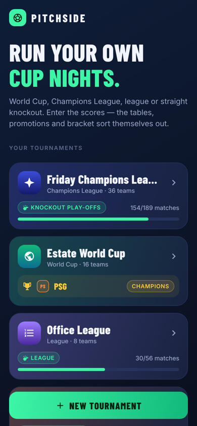
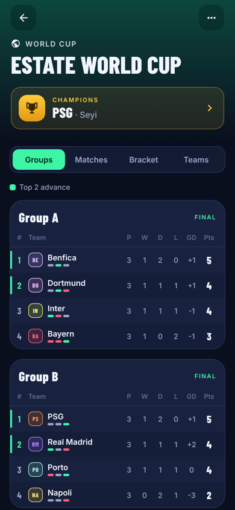
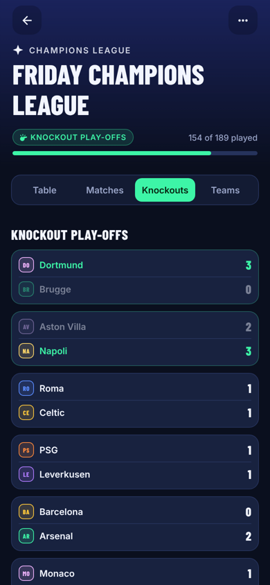
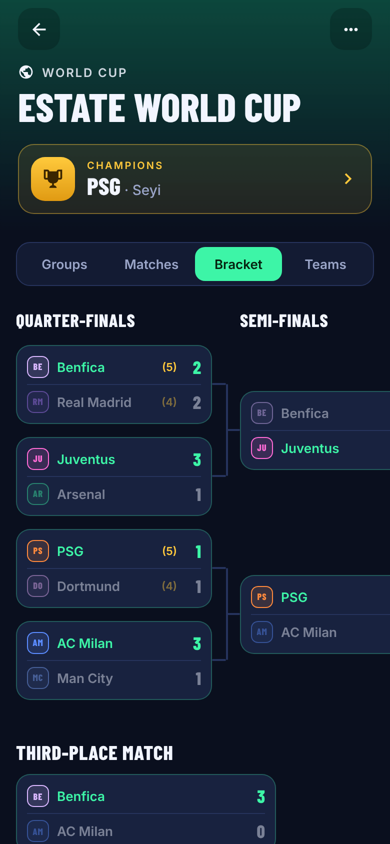
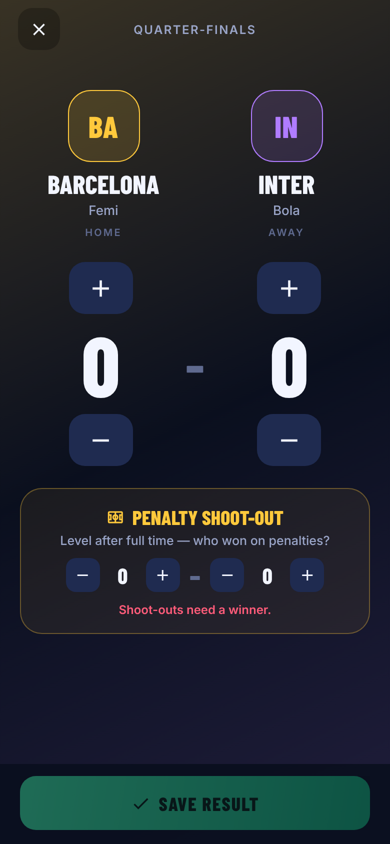
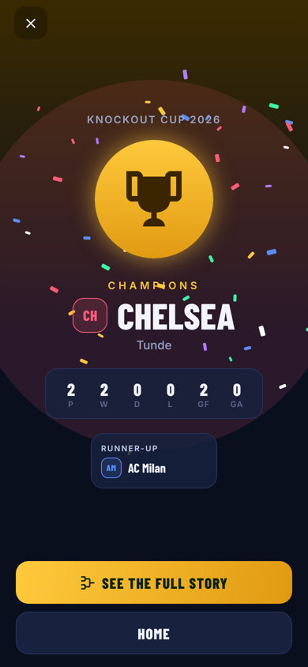
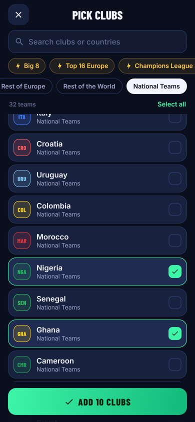
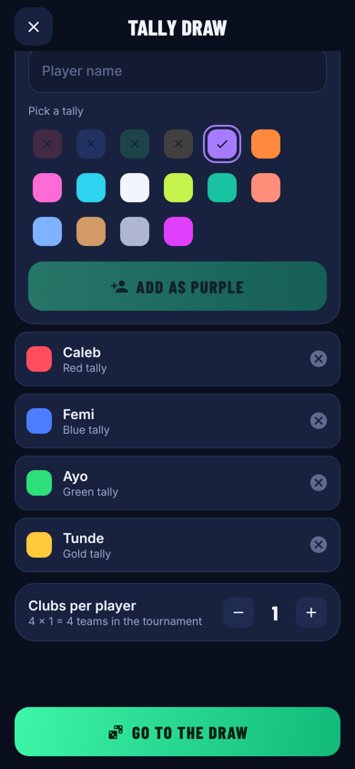
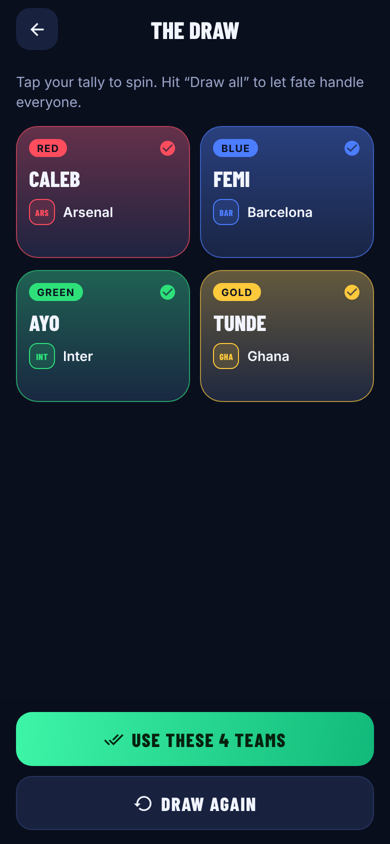

<p align="center">
  
</p>

<h1 align="center">Pitchside</h1>

<p align="center">
  <b>Run your own cup nights.</b><br/>
  Local football tournaments for eFootball, FC and friends — World Cup, Champions League, League and Knockout Cup.
</p>

<p align="center">
  
  
  
  
  
</p>

---

<p align="center">
  <a href="https://github.com/CalebTek/Pitchside/releases/latest/download/Pitchside.apk"><b>⬇ Download for Android</b></a> ·
  <a href="https://calebtek.github.io/Pitchside/">Website</a> ·
  <a href="https://calebtek.github.io/Pitchside/privacy.html">Privacy</a>
</p>

## Why Pitchside?

eFootball removed its cup competitions, but friends still want to play them. Pitchside brings them back. You set up the competition, play the games on your console and type in the scores. Pitchside does the rest: tables, tie-breakers, who goes through, the bracket, two-legged aggregates, penalty shoot-outs and the champion.

- **Offline-first:** everything is stored on the phone. No account, no server, no data costs.
- **Built for local play:** add a player name next to each club ("Arsenal – Caleb"), or paste a whole list in one go.
- **Top clubs, one tap:** 105 preset clubs and national teams with search, league filters and packs (Big 8, Top 16 Europe, Champions League 36, World Cup 32).
- **Tally draw:** each player picks a colour tally, then the app spins and gives them a random club, so nobody gets to keep their favourite team. You can hand out up to 4 clubs per player.
- **Fast entry:** big score buttons, haptic feedback, and penalties only show up when they're actually needed.

## Formats

| Format | How it works |
| --- | --- |
| **World Cup** | Draw into groups → top 1–4 per group (+ optional best 3rd-placed teams) → knockout bracket. Classic A1 v B2 crossover keeps group-mates apart until the final. Optional third-place match. |
| **Champions League** | Swiss-style **league phase** (one table, every team plays *N* different opponents) → top seeds go straight through, the next group play **knockout play-offs** (9th v 24th…) → two-legged knockouts → one-off final. |
| **League** | Single or double round robin. Most points wins. |
| **Knockout Cup** | Seeded bracket with automatic byes for the top seeds. Single or two-legged ties. |

**Rules engine highlights**
- Two-legged ties are decided on aggregate, then penalties (no away-goals rule).
- Table tie-breakers: points → goal difference → goals scored → wins → head-to-head.
- Win and draw points are configurable.
- If you edit an earlier score, every later result that depended on it is voided automatically.

## Screenshots

| Home | Groups | League phase |
| :---: | :---: | :---: |
|  |  |  |
| **Bracket** | **Score entry** | **Champion** |
|  |  |  |
| **Top clubs** | **Tally draw: players** | **Tally draw: reveal** |
|  |  |  |

## Tech stack

| Layer | Choice |
| --- | --- |
| App framework | Expo SDK 58 · React Native 0.88 (New Architecture, Hermes) |
| Language | TypeScript (strict) |
| Navigation | expo-router (file-based, native stack) |
| State | Zustand + `persist` middleware |
| Storage | AsyncStorage (on-device) |
| UI | Custom design system · expo-linear-gradient · Barlow Condensed + Inter fonts · MaterialCommunityIcons |
| Tests | Node + `tsx` running the pure engine test suite (121 tests) |
| Docs | Mermaid sources rendered to PNG with `npm run docs:diagrams` |
| Builds | Gradle (local APK) · EAS Build (Android / iOS in the cloud) |

More detail in [`docs/tech-stack.md`](docs/tech-stack.md).

## Getting started

```bash
git clone https://github.com/CalebTek/Pitchside.git
cd Pitchside
npm install

npm test            # run the tournament engine tests
npm run typecheck   # TypeScript check
npx expo start      # scan the QR code with Expo Go on your phone
```

## Building

```bash
# Android APK on your machine (needs JDK 17+ and the Android SDK)
npx expo prebuild -p android
cd android && ./gradlew assembleRelease

# Cloud builds with EAS
npm i -g eas-cli && eas login
eas build -p android --profile preview      # shareable APK
eas build -p android --profile production   # Play Store .aab
eas build -p ios                            # App Store (needs an Apple Developer account)
```

The full release checklist for Google Play and the App Store is in [`docs/build-and-release.md`](docs/build-and-release.md).

## Documentation

| Doc | What's inside |
| --- | --- |
| [Docs index](docs/README.md) | Start here |
| [C4 model](docs/c4-model.md) | Context, container, component and code views |
| [Architecture](docs/architecture.md) | Layers, design decisions, folder structure |
| [System flows](docs/system-flows.md) | Sequence diagrams for the main user journeys |
| [Tournament engine](docs/tournament-engine.md) | Draw, fixture and progression algorithms |
| [Data model](docs/data-model.md) | Types, persistence format, versioning |
| [Design system](docs/design-system.md) | Colours, type, components |
| [Tech stack](docs/tech-stack.md) | Libraries and why each was chosen |
| [Testing](docs/testing.md) | Test strategy and how to run it |
| [Build & release](docs/build-and-release.md) | APK, EAS, Play Store, App Store |
| [Distribution](docs/distribution.md) | Stores, requirements, recommended order |
| [Store kit](store/README.md) | Listing text, graphics, screenshots, data-safety answers |
| [Roadmap](docs/roadmap.md) | Planned features and monetisation ideas |

## Project structure

```
src/
├── app/            # Screens (expo-router file-based routes)
├── components/     # Reusable UI: MatchCard, StandingsTable, Bracket, ui kit
├── data/           # Built-in club & national-team catalogue
├── engine/         # Pure TypeScript tournament engine, tally draw + tests
├── store/          # Zustand store, persisted to AsyncStorage
└── theme/          # Colours, fonts, radii
assets/             # App icon, adaptive icon, splash
docs/               # Architecture & technical documentation
```

## Licence

**Proprietary. All rights reserved.** © 2026 Olawale Odeyemi Ebenezer (CalebTek).

The source code is public for reference only. You may not copy, modify, distribute or publish it, or use it commercially, without written permission. See [`LICENSE`](LICENSE) for the full terms.
