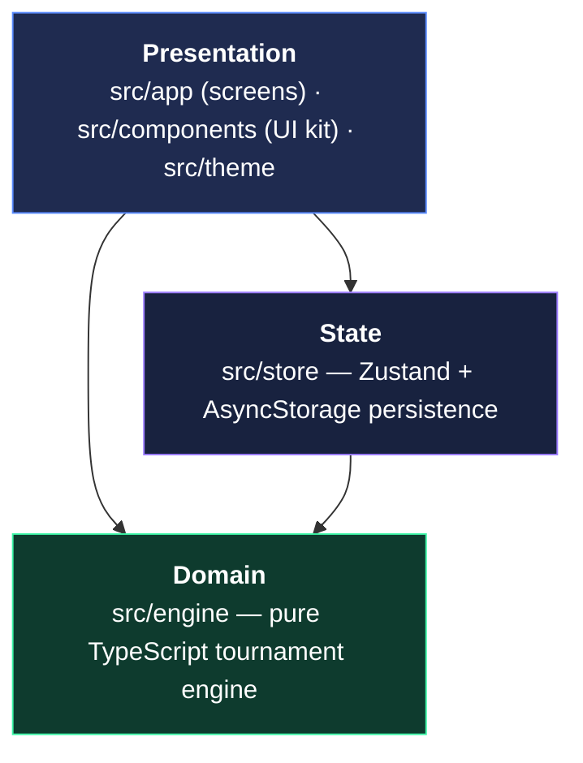

# Architecture

## Overview

Pitchside is a **single-container, offline-first mobile app** made of three layers. Dependencies only point one way: downwards.

<!-- diagram:layers -->


<details><summary>Mermaid source (<code>diagrams/src/layers.mmd</code>)</summary>



</details>
<!-- /diagram -->

| Layer | May import | Must not import |
| --- | --- | --- |
| Domain (`engine`) | Only itself | React, React Native, Expo, the store, the UI |
| State (`store`) | The engine, Zustand, AsyncStorage | Screens and components |
| Presentation | Everything below it | — |

Keeping the engine free of React means:
- it runs in plain Node, so the tests are fast and need no emulator;
- it could later run on a server (online leagues, a web dashboard) without changes;
- the rules can be checked on their own, without any UI.

## Key design decisions

| # | Decision | Why |
| --- | --- | --- |
| 1 | **Expo / React Native** for one codebase on Android and iOS | One TypeScript codebase, fast iteration with Expo Go, cloud iOS builds without a Mac. [ADR-001](adr/001-expo-react-native.md) |
| 2 | **Store inputs only, derive everything else** | Edits to old scores fix every table and bracket automatically. Nothing can get out of sync. [ADR-002](adr/002-derive-state-dont-store-it.md) |
| 3 | **Results remember their teams** (`Result.h`, `Result.a`) | If a change upstream sends different teams into a knockout slot, the old score no longer matches and is ignored. No cascade-delete code is needed |
| 4 | **Placeholder sources** for knockout slots | The full bracket can be drawn from day one ("Winner QF 2", "1st Group A") and fills itself in as results arrive |
| 5 | **Offline-first, on-device storage** | No running costs, works in places with poor data coverage, no sign-up. [ADR-003](adr/003-offline-first-storage.md) |
| 6 | **File-based routing** (expo-router) | Each screen has a URL, deep links come for free, and the navigation structure is the folder structure |
| 7 | **Own small design system** instead of a UI library | A distinctive look, a smaller bundle and full control over the dark theme |

## Folder structure

```
src/
├── app/                          # Routes (expo-router)
│   ├── _layout.tsx               # Root: fonts, splash, theme, stack
│   ├── index.tsx                 # Home
│   ├── new.tsx                   # Create wizard
│   └── t/[id]/
│       ├── index.tsx             # Tournament: tables / matches / bracket / teams
│       ├── champion.tsx          # Celebration screen
│       └── match/[mid].tsx       # Score entry (modal)
├── components/
│   ├── ui.tsx                    # Text, Button, Chip, Stepper, Toggle, TeamBadge…
│   ├── ClubPicker.tsx            # Preset club browser: search, league filter, packs
│   ├── TallyDraw.tsx             # Colour-tally random club draw
│   ├── MatchCard.tsx
│   ├── StandingsTable.tsx        # + ZoneLegend
│   ├── Bracket.tsx               # Bracket columns + TieCard
│   └── confirm.ts                # Cross-platform confirm / alert
├── engine/
│   ├── types.ts                  # All domain types
│   ├── generate.ts               # Draw, fixtures, bracket skeleton, validation
│   ├── resolve.ts                # Resolver: standings, progression, podium
│   ├── draw.ts                   # Tally colours + random club draw helpers
│   ├── index.ts                  # Public API of the engine
│   └── engine.test.ts            # Simulation-based test suite
├── data/clubs.ts                 # Built-in club & national-team catalogue
├── store/index.ts                # Zustand store + persistence
└── theme/index.ts                # Colours (C), fonts (F), radii (R), format gradients
```

## Routes

| Route | Screen | Presentation |
| --- | --- | --- |
| `/` | Home | Stack root |
| `/new` | Create wizard | Push |
| `/t/[id]` | Tournament | Push |
| `/t/[id]/match/[mid]` | Score entry | **Modal**, slides up from the bottom |
| `/t/[id]/champion` | Champion | Fade |

## Runtime behaviour

- **Rendering cost.** A `Resolver` is built inside `useMemo([tournament])`. It caches tables and tie views internally, so one render resolves each tie only once. A 36-team Champions League tournament (144 league matches plus knockouts) resolves in milliseconds.
- **Persistence.** Every store change is serialised to AsyncStorage under the key `pitchside-v1`. Data is reloaded automatically when the app opens.
- **Haptics.** Light taps on steppers, a medium tap on buttons, a success tap when saving a result. Turned off on web.
- **Fonts.** The splash screen stays visible until Barlow Condensed and Inter have loaded, so text never visibly switches fonts.

## Extension points

| Want to add… | Where |
| --- | --- |
| A new competition format | Add to `Format`, then add a branch in `createTournament`, `defaultSettings`, `validate`, `zoneFor` and the wizard's `SettingsForm`. Write a simulation test |
| A new tie-breaker | `computeTable` comparator in `resolve.ts` |
| Player/goal statistics | Extend `Result` (for example `scorers?`), then add a stats selector to the `Resolver` |
| More preset clubs or packs | `src/data/clubs.ts`: add a row to `DATA` or a new entry in `PACKS` |
| Cloud sync | Add a sync service next to `store/`. The data is already plain JSON |
| Sharing images of tables or brackets | A presentation-layer feature (for example `react-native-view-shot`). The engine doesn't change |
