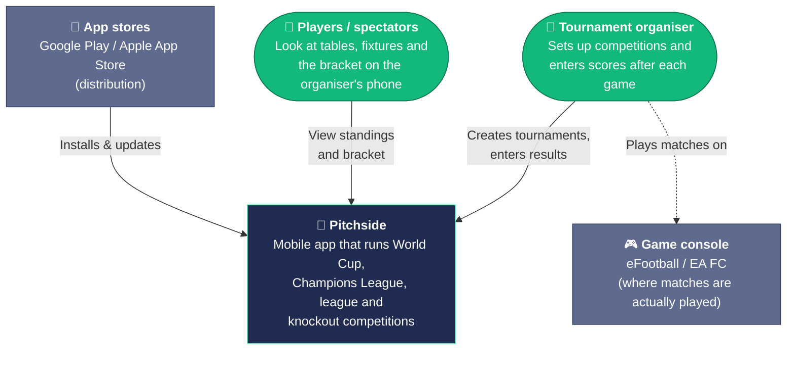
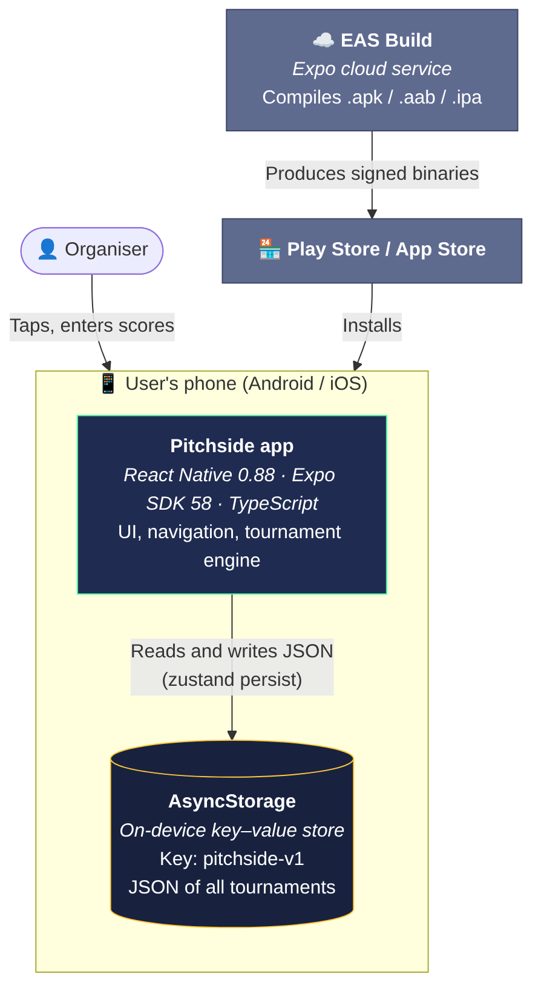
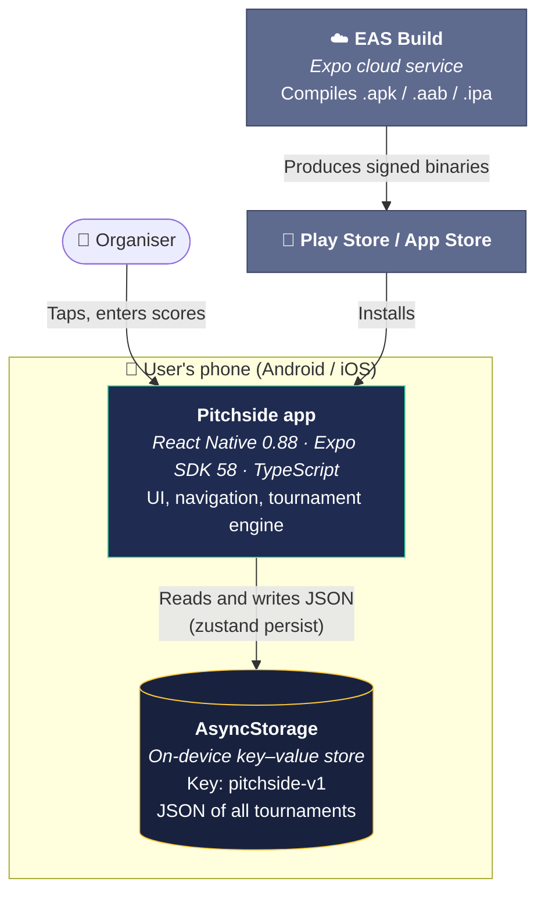
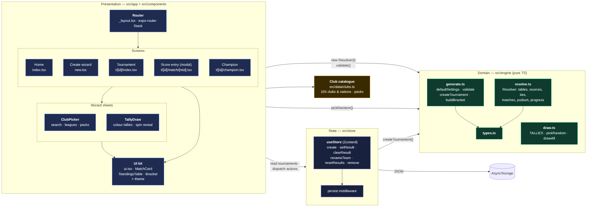
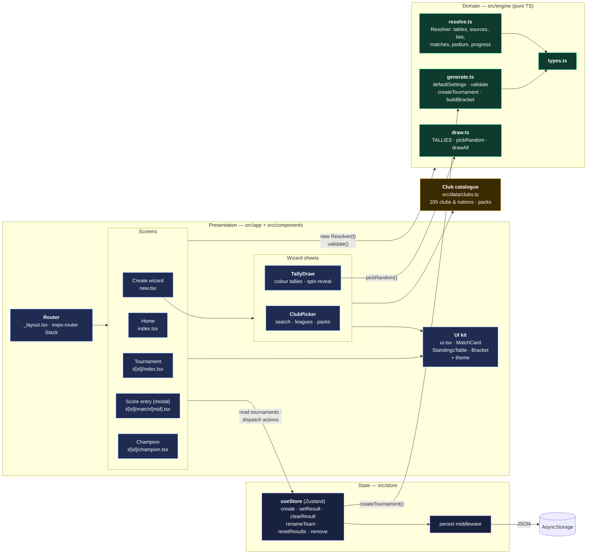
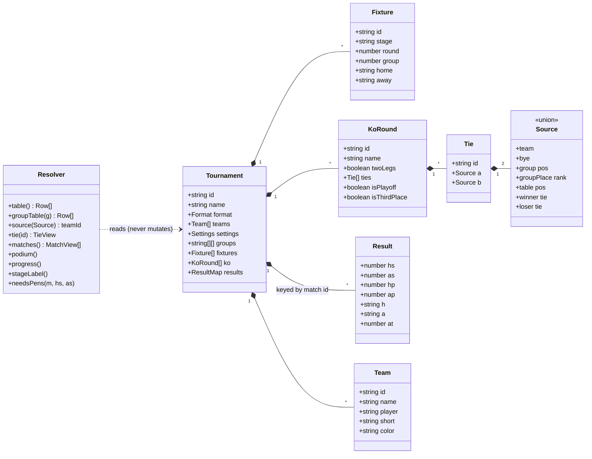

# C4 model

The [C4 model](https://c4model.com) describes software at four zoom levels: **Context → Containers → Components → Code**.

Pitchside 1.0 is a standalone, offline mobile app. Levels 1 and 2 are therefore small. Most of the interesting structure is at levels 3 and 4.

---

## Level 1 — System context

Who uses Pitchside and what it talks to.

<!-- diagram:c4-1-context -->

Mermaid source (<code>diagrams/src/c4-1-context.mmd</code>)

<!-- /diagram -->

**Key point:** the console and Pitchside are not connected. The organiser enters scores by hand, which is why the app works with any football game.

---

## Level 2 — Containers

A container is anything that runs code or stores data on its own.

<!-- diagram:c4-2-containers -->

Mermaid source (<code>diagrams/src/c4-2-containers.mmd</code>)

<!-- /diagram -->

| Container | Technology | Responsibility |
| --- | --- | --- |
| Pitchside app | React Native, Expo, TypeScript, Hermes JS engine | Everything the user sees and every tournament calculation |
| AsyncStorage | Native key–value store (SQLite on Android, files on iOS) | Keeps tournaments between app launches |
| EAS Build *(build time only)* | Expo cloud | Produces signed store binaries |

> There is **no backend** in 1.0. A cloud sync or account service would be a new container. See the [roadmap](roadmap.md).

---

## Level 3 — Components (inside the app)

<!-- diagram:c4-3-components -->

Mermaid source (<code>diagrams/src/c4-3-components.mmd</code>)

<!-- /diagram -->

### Component responsibilities

| Component | File(s) | Responsibility |
| --- | --- | --- |
| Router | `src/app/_layout.tsx` | Loads fonts, keeps the splash screen up until they're ready, sets the dark theme, declares the stack and the modal routes |
| Home | `src/app/index.tsx` | Lists tournaments with stage, progress and champion. Shows format tiles on first launch |
| Create wizard | `src/app/new.tsx` | Three steps: format → teams → rules. Checks the setup live and previews the structure |
| Tournament screen | `src/app/t/[id]/index.tsx` | Tabs for tables or groups, filtered match list, bracket and play-offs, and team renaming. Menu to clear scores or delete |
| Score entry | `src/app/t/[id]/match/[mid].tsx` | Score steppers, aggregate view, penalty shoot-out when needed. Goes to the champion screen when a result decides the final |
| Champion | `src/app/t/[id]/champion.tsx` | Trophy animation, confetti, champion's record, runner-up and third place |
| UI kit | `src/components/*` | Shared building blocks and the bracket layout |
| Store | `src/store/index.ts` | The single source of truth for saved data. Holds only *inputs* (setup and results) |
| Generator | `src/engine/generate.ts` | Turns a setup into fixtures and a knockout skeleton |
| Resolver | `src/engine/resolve.ts` | Works out *everything else* from the inputs: standings, who fills each slot, winners, the podium |

---

## Level 4 — Code (engine core)

The most important classes and types. See [data-model.md](data-model.md) for every field.

<!-- diagram:c4-4-code -->

Mermaid source (<code>diagrams/src/c4-4-code.mmd</code>)

<!-- /diagram -->

**Design rule:** a `Tournament` stores *what happened* (the setup and the scores). It never stores *what follows from it* (tables, qualifiers, winners). The `Resolver` recalculates those every time. Because of this, editing any score automatically corrects everything downstream. See [ADR-002](adr/002-derive-state-dont-store-it.md).
