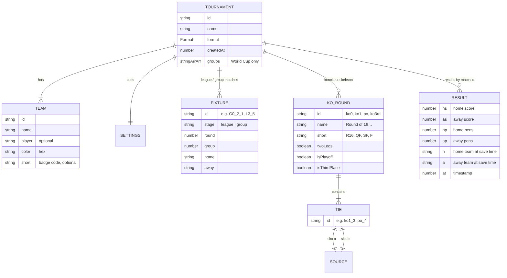
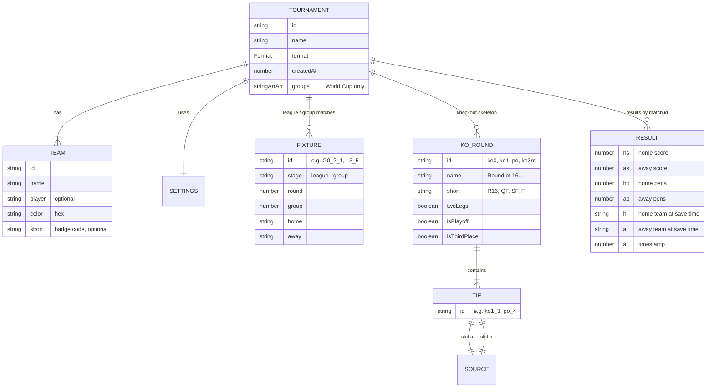

# Data model

All types live in `src/engine/types.ts`.

## Entity relationships

<!-- diagram:erd -->


<details><summary>Mermaid source (<code>diagrams/src/erd.mmd</code>)</summary>



</details>
<!-- /diagram -->

## Match identifiers

| Match | ID pattern | Example |
| --- | --- | --- |
| League fixture | `L_{round}_{i}` / `L{round}_{i}` (Swiss) | `L_4_2`, `L3_7` |
| Group fixture | `G{group}_{round}_{i}` | `G2_1_0` |
| Knockout leg | `{tieId}-{leg}` | `ko2_1-1`, `po_3-2` |

`results` is a map from match ID to `Result`. Knockout match IDs stay the same even when the teams in the slot change. That's why `Result.h` and `Result.a` exist.

## Club catalogue

`src/data/clubs.ts` is static data bundled with the app. It is not saved per tournament.

| Type | Fields | Notes |
| --- | --- | --- |
| `PresetClub` | `name`, `short` (3-letter code), `color`, `league` | 105 entries: 12 Premier League, 10 La Liga, 9 Serie A, 8 Bundesliga, 7 Ligue 1, 15 rest of Europe, 12 rest of the world, 32 national teams |
| `LEAGUES` | `key`, `name`, `short` | Filter chips in the picker |
| `PACKS` | `id`, `name`, `clubs` | One-tap sets: Big 8, Top 16 Europe, Champions League 36, World Cup 32 |

When a preset club is added, its `short` and `color` are copied onto the `Team`. After that the tournament no longer depends on the catalogue, so editing the catalogue never changes existing tournaments. Renaming a team clears its `short`, so the badge falls back to initials.

Only names and colours are stored. No crests or logos are bundled.

## Tally draw output

`TallyDraw` produces ordinary `Team` objects:

| Field | Value |
| --- | --- |
| `name`, `short` | The drawn club |
| `player` | The player who owned the tally |
| `color` | The tally colour, so all of a player's clubs share one colour |

## Derived (never stored) types

| Type | Produced by | Purpose |
| --- | --- | --- |
| `Row` | `computeTable` | One standings line: P W D L GF GA GD Pts + form |
| `MatchView` | `Resolver.matches()` | A playable match with its teams worked out, plus leg info, `locked`, `missingPens` and `firstLeg` |
| `TieView` | `Resolver.tie(id)` | Teams, byes, aggregate, penalties, winner and loser of a tie |

## Persistence

Stored by Zustand's `persist` middleware in AsyncStorage:

```jsonc
// key: "pitchside-v1"
{
  "state": {
    "tournaments": [ /* Tournament[] — newest first */ ]
  },
  "version": 0
}
```

### Size

A 36-team Champions League tournament with every result entered takes roughly 60–80 KB of JSON. AsyncStorage handles many such tournaments comfortably.

### Changing the schema safely

When a stored field changes shape:

1. Raise the store's `version` in `src/store/index.ts`.
2. Add a `migrate(persisted, fromVersion)` function to the persist options that upgrades older data.
3. Add new optional fields with safe defaults so older data still loads.
4. Never rename the storage key unless you also move the old data. Renaming it would lose users' tournaments.

```ts
persist(creator, {
  name: 'pitchside-v1',
  version: 1,
  migrate: (state: any, from) => {
    if (from < 1) state.tournaments.forEach((t: any) => (t.settings.awayGoals ??= false));
    return state;
  },
  storage: createJSONStorage(() => AsyncStorage),
});
```
