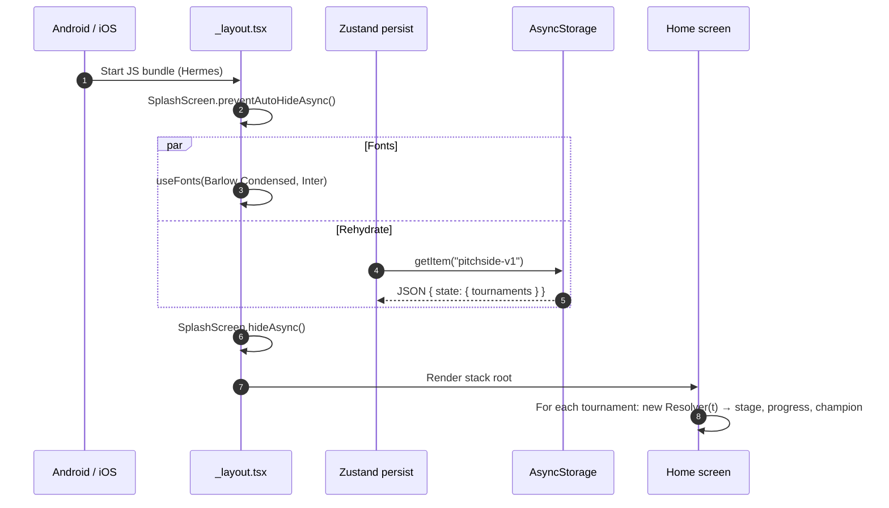
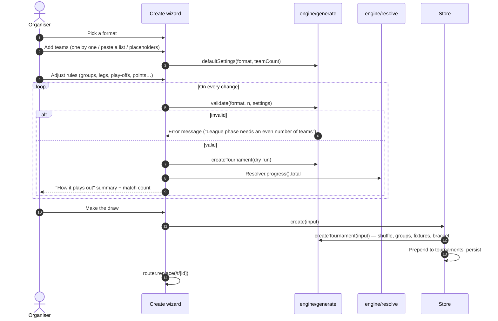
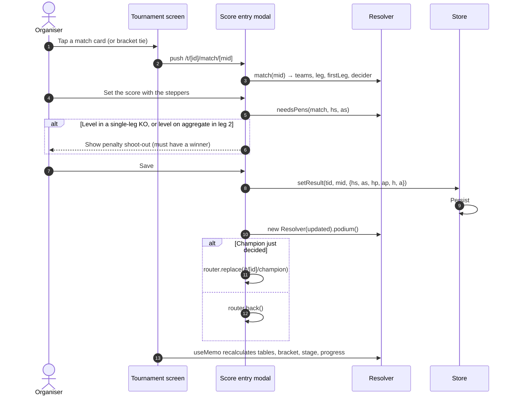
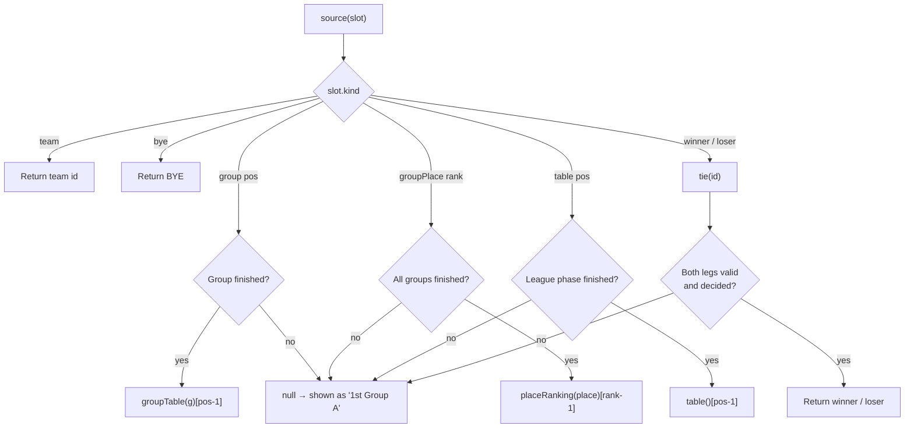
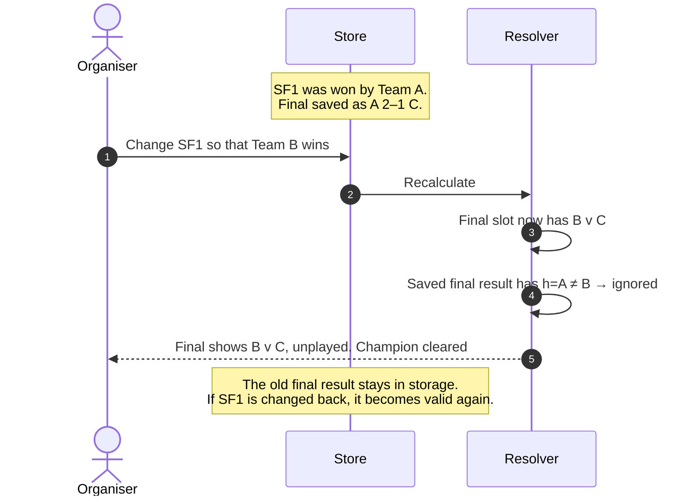
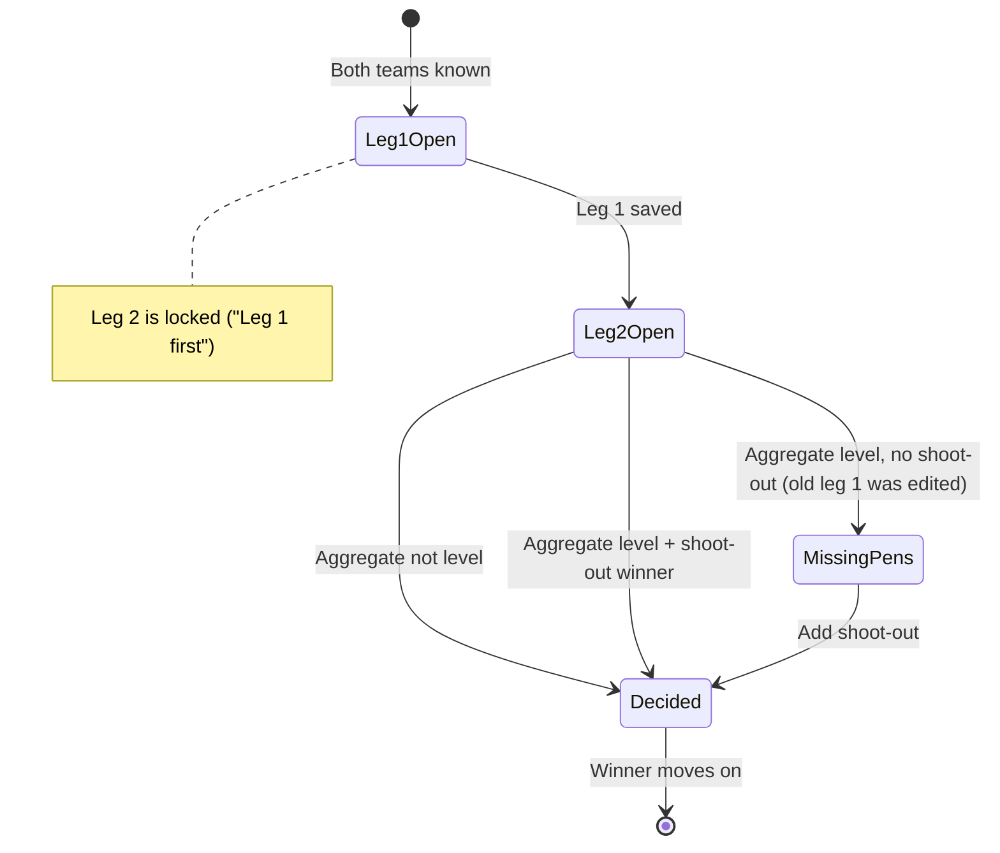
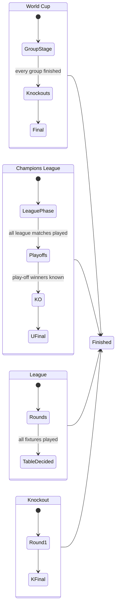

# System flows

Step-by-step views of the main user journeys.

## 1. App launch

## 2. Create a tournament

## 3. Enter a score

## 4. How a result moves teams forward

What the Resolver does when a knockout slot is read.

A saved score counts only if `result.h` and `result.a` still match the teams now in that slot.

## 5. Editing an earlier result

## 6. Two-legged tie

## 7. Tournament lifecycle by format

