# System flows

Step-by-step views of the main user journeys.

## 1. App launch

<!-- diagram:flow-launch -->

Mermaid source (<code>diagrams/src/flow-launch.mmd</code>)

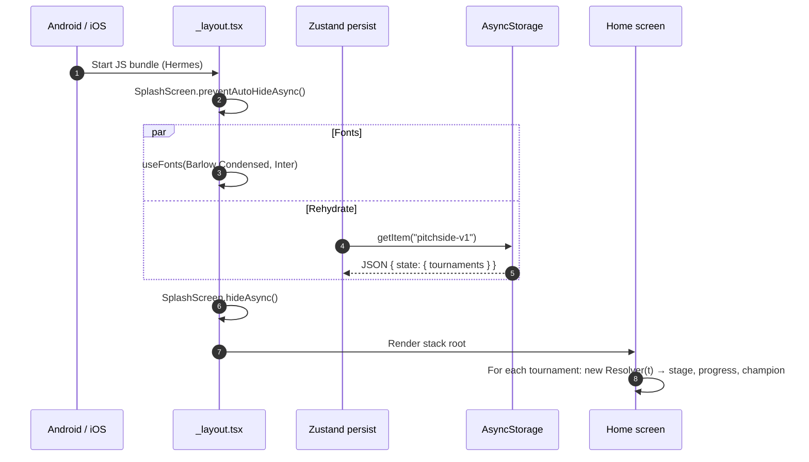

<!-- /diagram -->

## 2. Create a tournament

<!-- diagram:flow-create -->
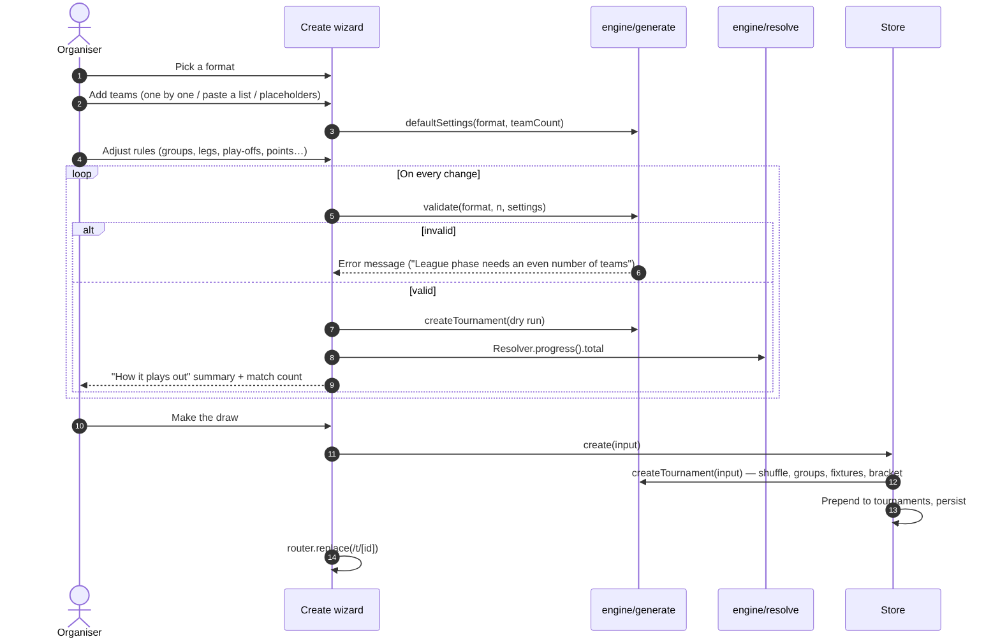

Mermaid source (<code>diagrams/src/flow-create.mmd</code>)

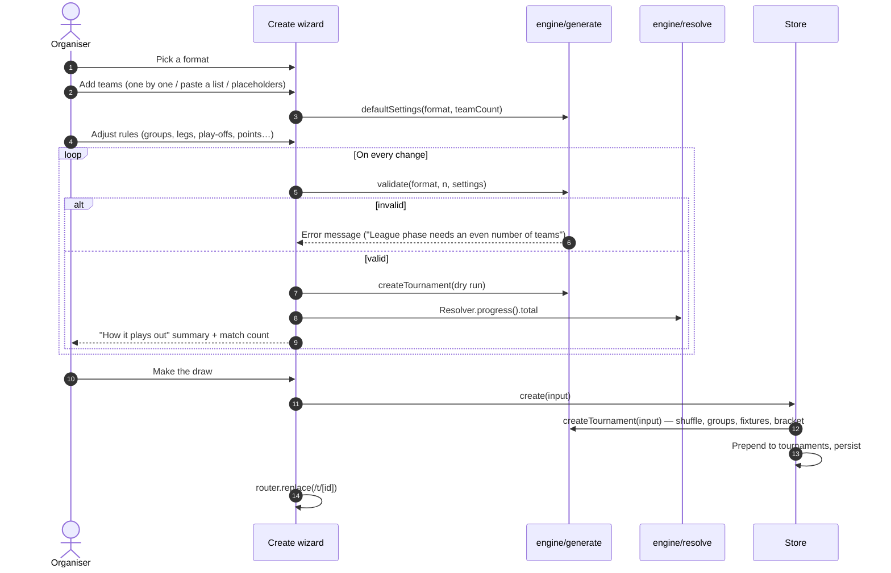

<!-- /diagram -->

## 3. Enter a score

<!-- diagram:flow-score-entry -->
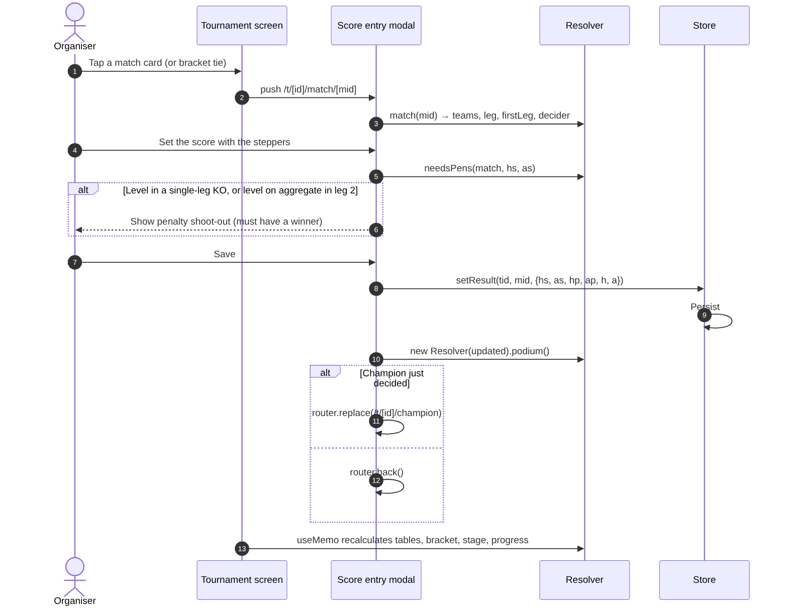

Mermaid source (<code>diagrams/src/flow-score-entry.mmd</code>)

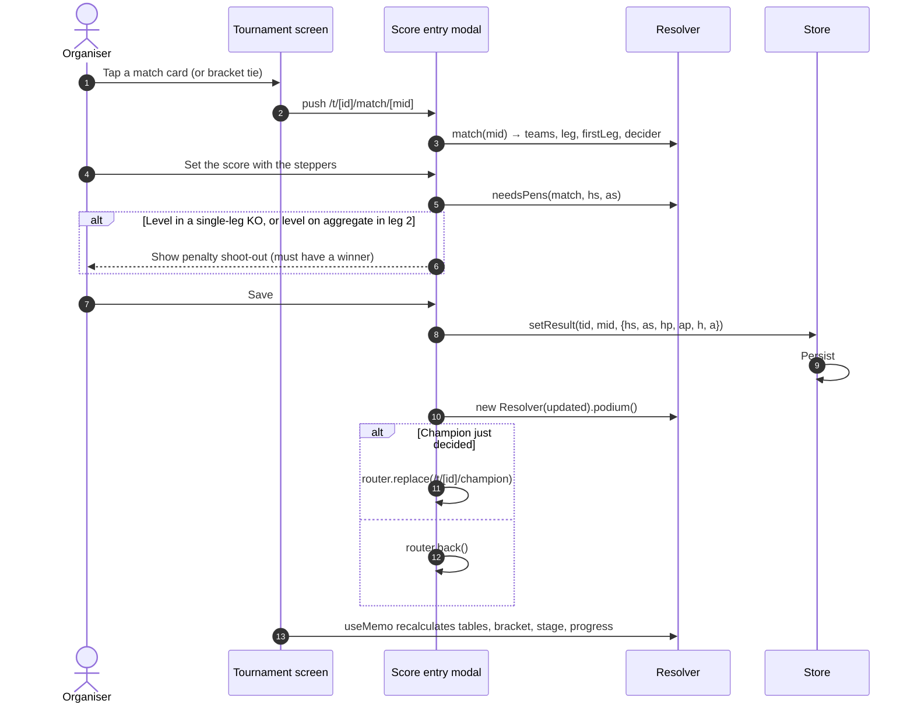

<!-- /diagram -->

## 4. How a result moves teams forward

What the Resolver does when a knockout slot is read.

<!-- diagram:flow-source-resolution -->

Mermaid source (<code>diagrams/src/flow-source-resolution.mmd</code>)

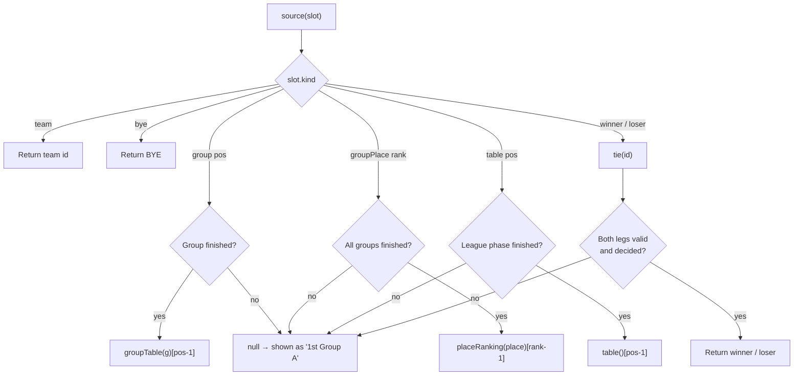

<!-- /diagram -->

A saved score counts only if `result.h` and `result.a` still match the teams now in that slot.

## 5. Editing an earlier result

<!-- diagram:flow-edit-result -->

Mermaid source (<code>diagrams/src/flow-edit-result.mmd</code>)

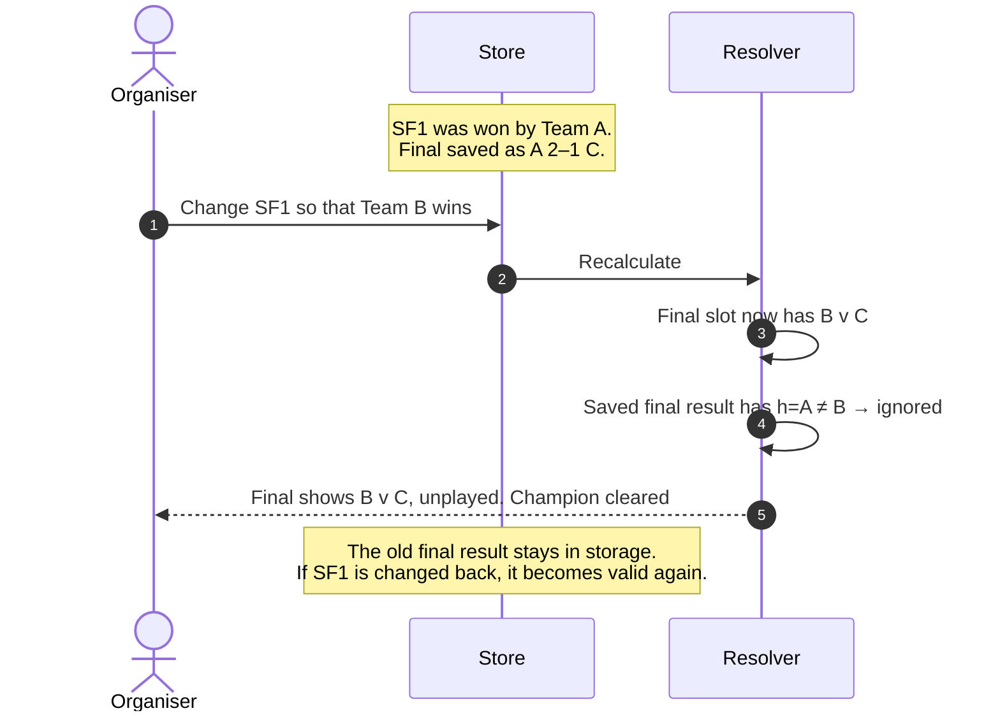

<!-- /diagram -->

## 6. Two-legged tie

<!-- diagram:flow-two-legged-tie -->

Mermaid source (<code>diagrams/src/flow-two-legged-tie.mmd</code>)

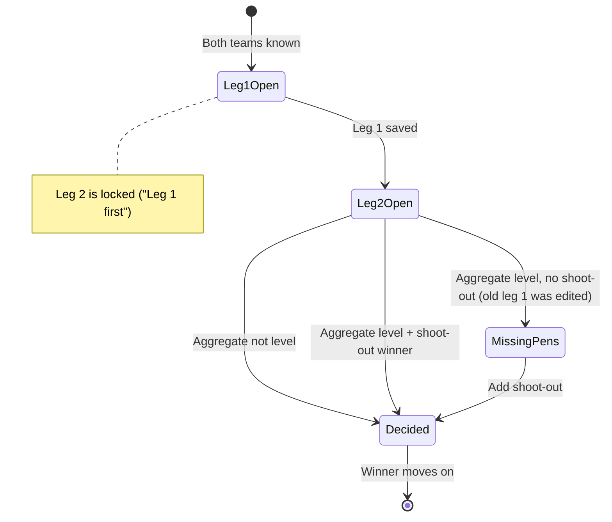

<!-- /diagram -->

## 7. Tally draw (random clubs for players)

Players each pick a colour tally. Each tally then spins and lands on a random club from the pool, so nobody gets to keep their usual team.

<!-- diagram:flow-tally-draw -->
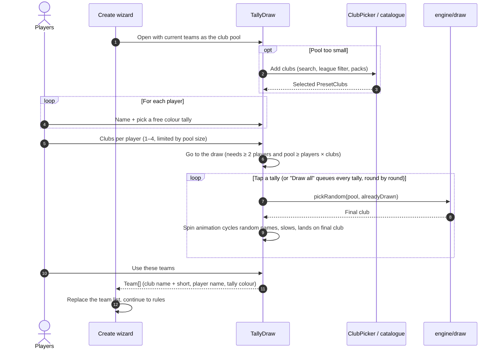

Mermaid source (<code>diagrams/src/flow-tally-draw.mmd</code>)

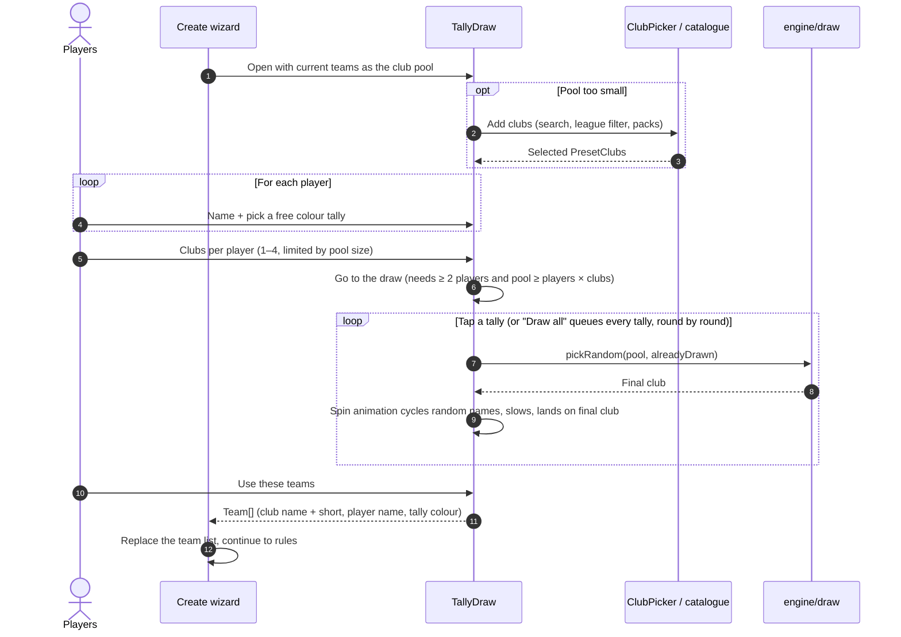

<!-- /diagram -->

## 8. Tournament lifecycle by format

<!-- diagram:flow-lifecycle -->
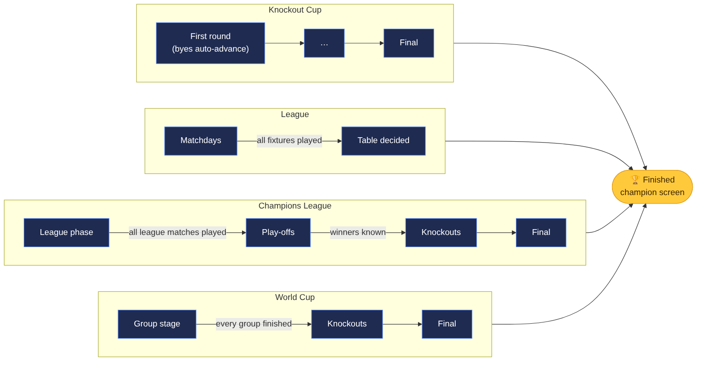

Mermaid source (<code>diagrams/src/flow-lifecycle.mmd</code>)

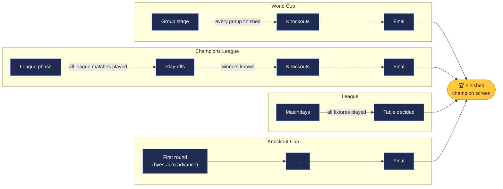

<!-- /diagram -->
