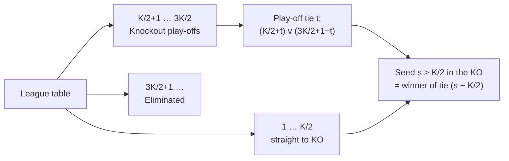

# Tournament engine

`src/engine` is a pure TypeScript library. Its public API is everything exported from `src/engine/index.ts`.

```ts
import { createTournament, defaultSettings, validate, Resolver } from '../engine';

const settings = defaultSettings('worldcup', teams.length);
const error = validate('worldcup', teams.length, settings);          // string | null
const t = createTournament({ name, format: 'worldcup', teams, settings, randomDraw: true });

const r = new Resolver(t);
r.groupTable(0);     // standings for Group A
r.matches();         // every playable match (fixtures + knockout legs)
r.podium();          // { champion, runnerUp, third }
```

---

## 1. Settings

| Setting | Used by | Default |
| --- | --- | --- |
| `doubleRoundRobin` | League, World Cup groups | League: `true`, others: `false` |
| `koTwoLegs` | Knockout rounds | UCL: `true`, others: `false` |
| `singleLegFinal` | Two-legged competitions | `true` |
| `thirdPlace` | World Cup, Knockout | World Cup: `true` |
| `groupCount` | World Cup | about `teams / 4` |
| `advancePerGroup` | World Cup | `2` |
| `bestThirds` | World Cup (only when 2 advance) | `0` |
| `leagueMatches` | UCL | `min(8, n-1)` |
| `koSize` | UCL — teams in the first main KO round | Largest power of 2 that leaves room for play-offs |
| `playoff` | UCL | `true` when `n ≥ 1.5 × koSize` |
| `winPoints` / `drawPoints` | All tables | `3` / `1` |

`validate()` returns a plain-English error for impossible setups, such as an odd number of teams in a league phase, too many groups for the number of teams, or more teams qualifying than a group holds.

---

## 2. Draw

- **Random draw** shuffles the teams using Fisher–Yates.
- **Seeded draw** keeps the order the teams were entered in, with the first team as seed 1.
- **Groups** are filled in a *snake* pattern (A→D, then D→A…). With a seeded list, each group gets one team from each "pot".

## 3. Fixture generation

### Round robin: circle method

```
Round 1        Round 2        (team 1 stays fixed, the others rotate)
1 – 6          1 – 5
2 – 5          6 – 4
3 – 4          2 – 3
```

- An odd number of teams gets a phantom "bye" slot.
- Home and away alternate by round and position.
- With `doubleRoundRobin`, the second half repeats the first with home and away swapped.
- In a World Cup, matchday *k* holds round *k* of every group, so the groups move forward together.

### Champions League league phase (Swiss style)

Every team must play exactly `m` **different** opponents.

1. Shuffle the teams and build a full round robin: `n-1` rounds, each a perfect matching.
2. Shuffle the rounds and keep `m` of them.

Every round is a perfect matching, and rounds never repeat a pairing. So every team plays exactly `m` games, each against a different opponent, spread over `m` matchdays. An even team count is required.

## 4. Knockout bracket

### Seeded bracket order

`seedOrder(size)` builds the standard order in which seeds 1 and 2 can only meet in the final:

```
size 8 → [1, 8, 4, 5, 2, 7, 3, 6]   → pairs 1v8, 4v5, 2v7, 3v6
```

If there are fewer entries than the bracket size (the next power of 2), the missing seeds become **byes**. They always face the top seeds, and the opponent goes through automatically.

### World Cup knockout entry

| Situation | Bracket |
| --- | --- |
| Top 2 advance, groups = 2/4/8/16, no best thirds | **Classic crossover**: A1–B2, C1–D2 … in the top half and B1–A2, D1–C2 … in the bottom half. Group-mates can only meet in the final |
| Anything else (top 1, top 3, odd group counts, best thirds) | **Ranked seeding**: all group winners ranked by points, GD and GF; then all runners-up; then the best thirds. They're placed into a seeded bracket with byes |

### Champions League knockout entry (`koSize = K`)

<!-- diagram:ucl-knockout-entry -->


<details><summary>Mermaid source (<code>diagrams/src/ucl-knockout-entry.mmd</code>)</summary>



</details>
<!-- /diagram -->

For the real format (36 teams, K = 16): 9th plays 24th … 16th plays 17th. In the Round of 16, 1st plays the winner of 16th v 17th, and 8th plays the winner of 9th v 24th.

### Third-place match

Placed between the semi-finals and the final, using the **losers** of both semi-finals.

## 5. Tally draw

`src/engine/draw.ts` handles the random club draw used before a tournament is created.

- `TALLIES`: 16 named colours (Red, Blue, Green, Gold…). Each player takes one, so there can be at most 16 players.
- `pickRandom(pool, taken)`: picks a club uniformly at random from those not yet drawn.
- `drawAll(pool, players, perPlayer)`: draws every club at once, **round by round** (everyone's 1st club, then everyone's 2nd…). Throws an error if `pool < players × perPlayer`.
- `maxPerPlayer(pool, players)`: the most clubs each player can get from this pool.

The UI calls `pickRandom` one tap at a time. Every spin draws from the clubs still left, so the result is equally fair whether players tap one by one or press **Draw all**. The spinning animation is only for show: the club is chosen before the animation starts.

## 6. Resolution

The `Resolver` takes a tournament and works everything out from the stored scores, caching results as it goes.

### Standings: `computeTable`

1. Use only results whose saved teams still match the fixture.
2. Add up P, W, D, L, GF, GA and points. Form is the last five results in match order.
3. Sort by **points → goal difference → goals for → wins → head-to-head points → name**.

### Sources

Each knockout slot holds a `Source`. When the earlier stage isn't finished yet, the Resolver returns `null`, and the UI shows a label such as *"1st Group A"*, *"Best 3rd #2"*, *"9th in league"* or *"Winner QF 2"*.

| Kind | Becomes a team when |
| --- | --- |
| `team` | Immediately |
| `bye` | Never (always a bye) |
| `group` | That group has finished |
| `groupPlace` | Every group has finished |
| `table` | Every league-phase match has been played |
| `winner` / `loser` | The referenced tie is decided |

### Deciding a tie

| Tie type | Rule |
| --- | --- |
| Single match | Higher score wins. If level, penalties (`hp`/`ap`) must have a winner |
| Two legs | Leg 1: A at home. Leg 2: B at home. Aggregate = A(leg1 home) + A(leg2 away). If level, the penalties saved on **leg 2** decide it |
| Bye | The other side goes through as soon as it's known |

`needsPens(match, hs, as)` tells the score screen when to ask for a shoot-out:
- a single-leg knockout match that ends level, or
- a second leg where *leg-1 score + this score* is level on aggregate.

The second leg stays **locked** until leg 1 has a score. If leg 1 is later edited so the aggregate becomes level with no shoot-out saved, leg 2 is flagged `missingPens`.

### Podium and progress

- **League:** podium = top three of the final table, once every fixture is played.
- **Cups:** champion and runner-up from the final, third from the third-place match.
- **Progress** counts every match the competition *will* need, including ones whose teams aren't known yet, not just the ones currently playable. Bye ties are skipped.
